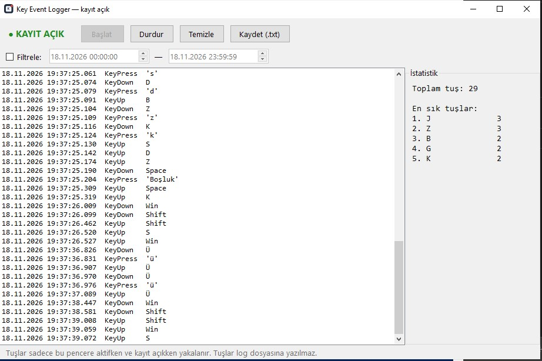
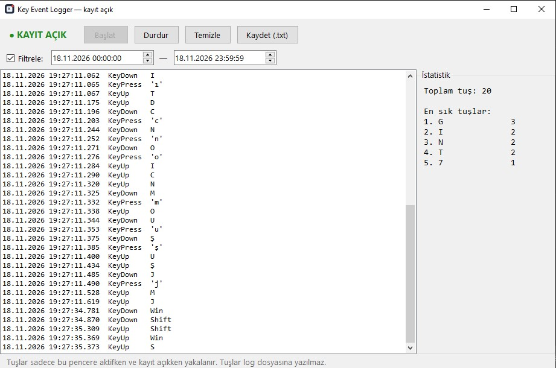

# Key Event Logger (Eğitsel Tuş Kaydedici)

<p align="center"></p>

Klavye olaylarının (KeyDown, KeyPress, KeyUp) Windows Forms'ta nasıl yakalandığını ve nasıl işlendiğini
gösteren eğitsel bir masaüstü uygulaması. **YMH219 Nesne Tabanlı Programlama** dersinin 2. uygulama ödevidir.

| | |
|---|---|
| **Öğrenci** | Ali İstanbullu |
| **Öğrenci No** | 250542019 |
| **Ders** | YMH219 Nesne Tabanlı Programlama |
| **Sürüm** | 1.0.0 |

> **Bu bir sistem keylogger'ı değildir.** Uygulama tuşları **yalnızca kendi penceresi aktifken** ve
> kayıt açıkken yakalar. Global hook, gizli/arka planda çalışma, başlangıçta otomatik açılma,
> başka uygulamalardan veri toplama ve ağ üzerinden gönderme **yoktur**. Basılan tuşlar log dosyasına
> da yazılmaz; sadece ekranda ve kullanıcının kendi seçtiği .txt dosyasında bulunur.

## Ekran Görüntüleri

| Kayıt açık | Filtre | Kaydedilen dosya |
|---|---|---|
|  |  |  |

## Özellikler

- **Üç klavye olayı:** Her tuş için `KeyDown` (basıldı), `KeyPress` (karakter yazıldı) ve `KeyUp` (bırakıldı) ayrı satırda, milisaniyeli zamanla gösterilir. Ctrl/Shift/Alt basılıysa satırın sonunda yazar.
- **Başlat / Durdur:** Kayıt sadece "Başlat"tan sonra yapılır. Sol üstte yeşil **● KAYIT AÇIK** / kırmızı **● KAYIT KAPALI** göstergesi ve pencere başlığı durumu gösterir.
- **Temizle:** Listeyi ve istatistiği sıfırlar.
- **Kaydet (.txt):** Ekranda görünen kayıtlar "Farklı Kaydet" penceresiyle seçilen dosyaya yazılır (UTF-8, Türkçe karakterler doğru görünür). Dosyanın başında oluşturulma zamanı, filtre ve kayıt sayısı bulunur.
- **İstatistik** (isteğe bağlı geliştirme): toplam tuş sayısı ve en sık basılan 5 tuş, canlı güncellenir.
- **Tarih/saat filtresi** (isteğe bağlı geliştirme): başlangıç-bitiş aralığındaki kayıtlar gösterilir; istatistik ve Kaydet de filtreye uyar.
- **Klavye düzenine uygun tuş adları:** Türkçe Q klavyede `i` tuşu Windows'ta `OemQuotes` olarak gelir; uygulama bunu aktif klavye düzeninden sorup `İ` olarak gösterir (ı, ü, ğ, ş, ç, ö de aynı şekilde).
- **Çökmez:** Her işlem `try/catch` ile korunur. Kullanıcının bilmesi gereken hatalar sebebiyle gösterilir (örnek: *"Kayıtlar dosyaya yazılamadı: dosya başka bir programda açık. Kapatıp tekrar deneyin."*), diğerleri sadece loga yazılır.

## Kurulum ve Çalıştırma

### Kurulum dosyasıyla

1. [Releases](https://github.com/Ali-Istanbullu/YMH219-KeyEventLogger/releases) sayfasından `KeyEventLogger-Kurulum-1.0.0.exe` dosyasını indirin.
2. Çalıştırın. Bilgisayarda **.NET 10 Desktop Runtime** yoksa kurulum onu Microsoft'tan indirip kurar (internet gerekir).

### Kaynak koddan

Gerekenler: Windows x64, [.NET SDK 10.0.401](https://dotnet.microsoft.com/download/dotnet/10.0) (`global.json` ile sabit).

```
git clone https://github.com/Ali-Istanbullu/YMH219-KeyEventLogger.git
cd YMH219-KeyEventLogger
dotnet build
dotnet test
dotnet run --project src/KeyEventLogger.WinForms
```

Kurulum dosyasını üretmek için ([Inno Setup 7](https://jrsoftware.org/isdl.php)):

```
dotnet run --project src/KeyEventLogger.IconGenerator -- assets
dotnet publish src/KeyEventLogger.WinForms -c Release -r win-x64 --self-contained false -o publish/KeyEventLogger
ISCC.exe installer\KeyEventLogger.iss
```

## Kullanılan Teknolojiler

| Teknoloji | Sürüm | Ne için |
|---|---|---|
| C# / .NET | .NET 10 (SDK 10.0.401) | Dil ve platform |
| Windows Forms | .NET 10 | Pencere, KeyDown/KeyPress/KeyUp, ListBox, SaveFileDialog |
| StreamWriter (`System.IO`) | .NET 10 | .txt dosyasına yazma |
| Microsoft.Extensions.DependencyInjection | 11.0.0 | Bağımlılık enjeksiyonu (DI) |
| Serilog + Serilog.Sinks.File | 4.4.0 / 7.0.0 | Uygulama logu (1 MB × 5 dosya) |
| MSTest | 4.0.2 | Birim testleri (57 test) |
| Inno Setup | 7.1.0 | Kurulum dosyası |

## Proje Yapısı ve Mimari

```
src/
  KeyEventLogger.Core            İş mantığı: kayıt oturumu, istatistik, filtre, biçimleme, presenter. Windows'a bağlı değil.
  KeyEventLogger.Infrastructure  Serilog log, .txt yazıcı, saat, klasör yolları
  KeyEventLogger.WinForms        Pencere (AnaForm), Kaydet penceresi, tuş adı çevirici, Program.cs (DI)
  KeyEventLogger.IconGenerator   İkonu (PNG + ICO) GDI+ ile üreten araç
tests/
  KeyEventLogger.Core.Tests            42 test
  KeyEventLogger.Infrastructure.Tests  15 test
installer/KeyEventLogger.iss     Inno Setup betiği
docs/DECISIONS.md                Projede alınan tüm kararlar ve hata haritası
```

- **MVP deseni:** `AnaForm` sadece gösterir ve olayları bildirir; kararları `KayitYoneticisi` (presenter) verir.
- **SOLID:** Her sınıfın tek görevi var (ör. `SatirBicimleyici` sadece satırı, `DosyaIcerigiOlusturucu` sadece dosya içeriğini üretir). Sınıflar birbirini arayüzler üzerinden kullanır.
- **Bağımlılık enjeksiyonu:** Nesneler yalnızca `Program.cs`'te bağlanır.
- **Hata kataloğu:** Bütün hata mesajları `Core/Errors/HataMesajlari.cs`'te adıyla tanımlı.
- **Testler:** Mock kütüphanesi yok, sahte sınıflar elle yazıldı.

Log: `%LocalAppData%\KeyEventLogger\logs\keyeventlogger.log` (sadece uygulama olayları ve hatalar, tuşlar değil).

## Kod Sözlüğü

Kod Türkçe ve ASCII karakterlerle yazılmıştır.

| Kod | Anlamı | English |
|---|---|---|
| `TusOlayi` | Yakalanan tek bir klavye olayı | Key event |
| `OlayTuru` (`TusBasildi`, `KarakterYazildi`, `TusBirakildi`) | KeyDown, KeyPress, KeyUp | Event type |
| `KayitOturumu` | Kayıt açık mı + olay listesi | Recording session |
| `TusIstatistikHesaplayici` | Toplam ve en sık tuşlar | Key statistics calculator |
| `KayitFiltreleyici` / `FiltreDogrulayici` | Tarih aralığına göre süzme / filtre doğrulama | Filter / filter validator |
| `SatirBicimleyici` | Bir olayı tek satıra çevirir | Line formatter |
| `DosyaIcerigiOlusturucu` | .txt dosyasının içeriği | File content builder |
| `DosyaHatasiAciklayici` | Dosya hatasının sebebini anlaşılır yazar | File error explainer |
| `KayitYoneticisi` | Presenter: butonlar, tuşlar, filtre | Recording manager (presenter) |
| `HataMesajlari` | Hata kataloğu | Error messages |
| `MetinDosyasiYazici` | StreamWriter ile dosya yazar | Text file writer |
| `SerilogGunlukcu` | Log yazar | Logger |
| `HataBildirici` | Hatayı ekrana ve/veya loga iletir | Error reporter |
| `AnaForm` | Ana pencere | Main form |
| `TusAdiCevirici` / `WindowsKlavyeDuzeni` | Tuş kodunu klavye düzenine göre ada çevirir | Key name converter / keyboard layout |
| `KaydetmeDiyalogu` | "Farklı Kaydet" penceresi | Save dialog |

Arayüzler `I` ile başlar (`IKayitOturumu`, `IDosyaYazici` ...). Sahte test sınıfları `Sahte` ile başlar.

## Bilinen Sınırlamalar

- **Sadece Windows x64.**
- **Sadece kendi penceresi:** Uygulama arka plandayken veya simge durumundayken tuş yakalamaz (bilerek, PDF güvenlik sınırı).
- **Filtre kutuları odaktayken** yazılan tuşlar hem kaydedilir hem tarih kutusunu değiştirir; kayıt için listeye tıklayın.
- **Tek başına Alt / F10** pencere menüsünü açmasın diye engellenmiştir (Alt+Space menüsü çalışır).
- **SmartScreen uyarısı:** Kurulum dosyası kod imzalı değildir; "Ek bilgi → Yine de çalıştır" ile devam edilir.
- Kayıtlar bellekte tutulur; uygulama kapanınca kaydedilmemiş kayıtlar silinir.

## Lisans

[MIT](LICENSE) © 2026 Ali İstanbullu
