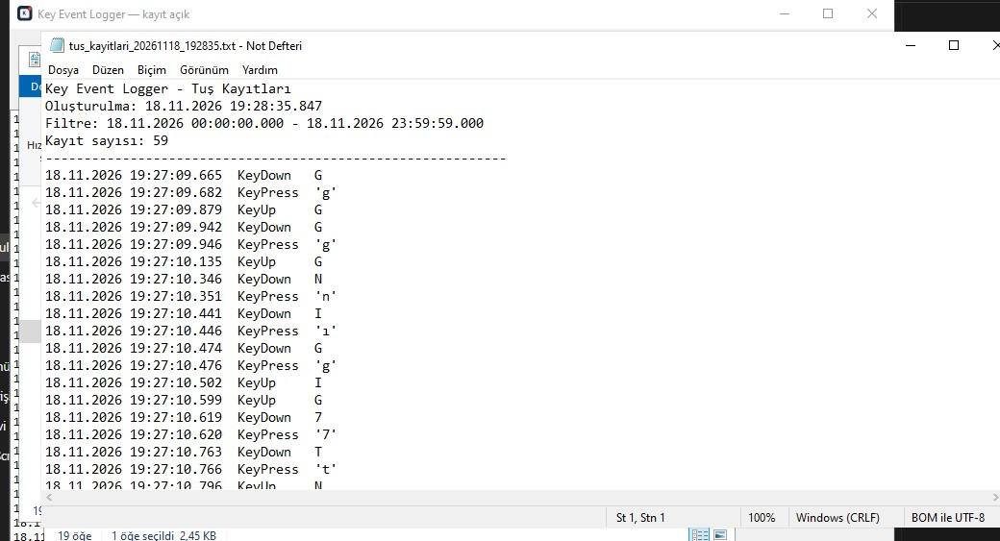

# Key Event Logger (Eğitsel Tuş Kaydedici)

[](https://github.com/Ali-Istanbullu/YMH219-KeyEventLogger/actions/workflows/ci.yml)

<p align="center"></p>

Klavye olaylarının (KeyDown, KeyPress, KeyUp) Windows Forms'ta nasıl yakalandığını gösteren eğitsel bir uygulama.
**YMH219 Nesne Tabanlı Programlama** — 2. uygulama ödevi.

**Ali İstanbullu — 250542019**

> Bu bir sistem keylogger'ı değildir: tuşlar **yalnızca uygulamanın kendi penceresi aktifken** ve kayıt açıkken
> yakalanır. Global hook, arka planda çalışma ve ağ üzerinden gönderme yoktur. Tuşlar log dosyasına yazılmaz.

## Ekran Görüntüleri

| Kayıt açık | Filtre | Kaydedilen dosya |
|---|---|---|
|  |  |  |

## Özellikler

- Her tuş için `KeyDown`, `KeyPress`, `KeyUp` ayrı satırda, milisaniyeli zamanla (ListBox).
- **Başlat / Durdur / Temizle** ve kayıt durumu göstergesi (● KAYIT AÇIK / KAPALI).
- **Kaydet (.txt):** ekrandaki kayıtlar `StreamWriter` ile seçilen dosyaya yazılır (UTF-8).
- **İstatistik:** toplam tuş ve en sık 5 tuş. **Filtre:** tarih/saat aralığı.
- Tuş adları aktif klavye düzenine göre gösterilir (Türkçe Q'da `OemQuotes` değil `İ`).

## Çalıştırma

**Kurulum:** [Releases](https://github.com/Ali-Istanbullu/YMH219-KeyEventLogger/releases) → `KeyEventLogger-Kurulum-1.0.0.exe`.
.NET 10 Desktop Runtime yoksa kurulum onu indirip kurar.

**Kaynak koddan** (Windows x64, .NET SDK 10.0.401):

```
dotnet build
dotnet test
dotnet run --project src/KeyEventLogger.WinForms
```

## Teknolojiler

C# / .NET 10, Windows Forms, Microsoft.Extensions.DependencyInjection 11.0.0, Serilog 4.4.0 (+ Sinks.File 7.0.0),
MSTest 4.0.2, Inno Setup, GitHub Actions.

## Proje Yapısı

```
src/KeyEventLogger.Core             İş mantığı ve presenter (Windows'a bağlı değil)
src/KeyEventLogger.Infrastructure   Log, .txt yazıcı
src/KeyEventLogger.WinForms         Pencere ve Program.cs
src/KeyEventLogger.IconGenerator    İkonu üreten araç
tests/...Core.Tests, ...Infrastructure.Tests   Birim testleri (57)
tests/...SmokeTests                 Uygulama ayağa kalkıyor mu, uçtan uca akış (3)
tests/...PerformanceTests           100.000 olayda süre ölçümleri (5)
installer/KeyEventLogger.iss        Inno Setup betiği
.github/workflows                   CI (her push'ta derle + test), Release (v* etiketiyle kurulum exe'si)
```

## Kod Sözlüğü

| Kod | Anlamı |
|---|---|
| `TusOlayi`, `OlayTuru` | Bir klavye olayı; KeyDown / KeyPress / KeyUp |
| `KayitOturumu` | Kayıt açık mı + olay listesi |
| `KayitYoneticisi` | Presenter: butonlar, tuşlar, filtre |
| `SatirBicimleyici`, `DosyaIcerigiOlusturucu` | Ekrandaki satır, .txt içeriği |
| `TusIstatistikHesaplayici`, `KayitFiltreleyici` | İstatistik, filtre |
| `MetinDosyasiYazici` | StreamWriter ile dosya yazar |
| `AnaForm` | Ana pencere |

## Sınırlamalar

- Sadece Windows x64; tuşlar sadece uygulama penceresi aktifken yakalanır.
- Kayıtlar bellekte tutulur; kaydedilmeden kapatılırsa kaybolur.
- Kurulum dosyası imzalı değil; SmartScreen uyarısında "Ek bilgi → Yine de çalıştır".

## Lisans

[MIT](LICENSE) © 2026 Ali İstanbullu
